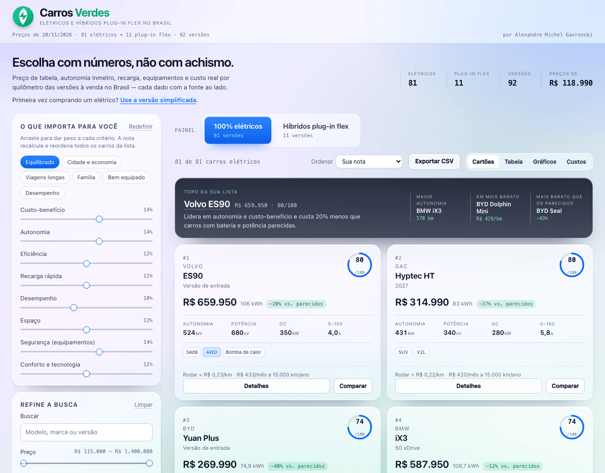
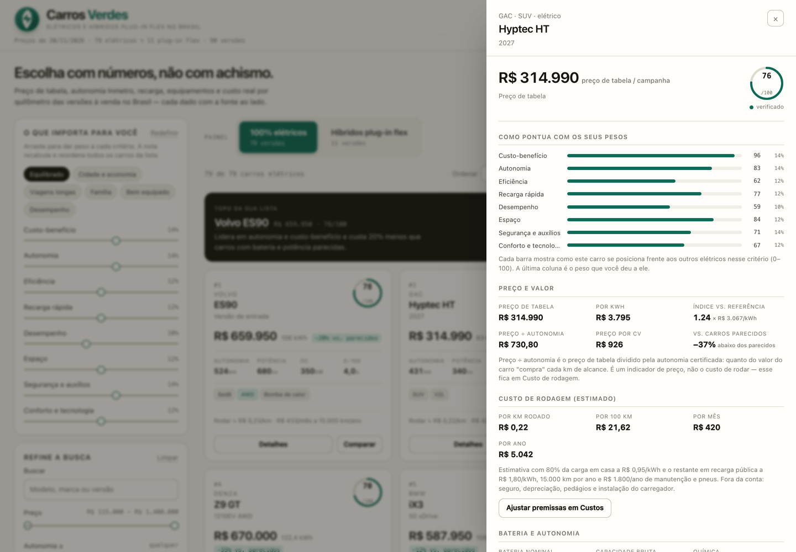
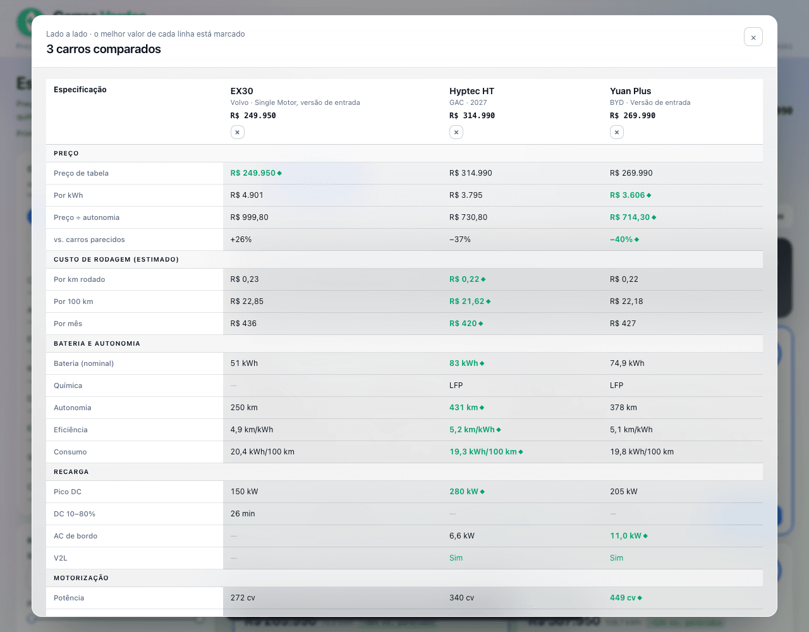
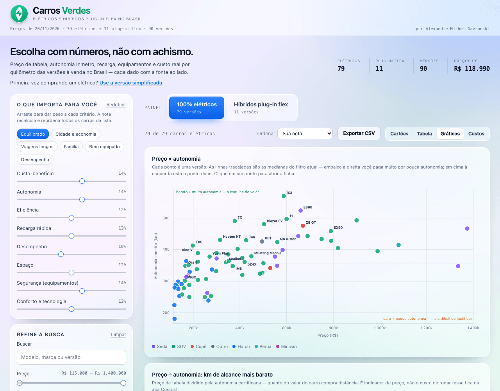
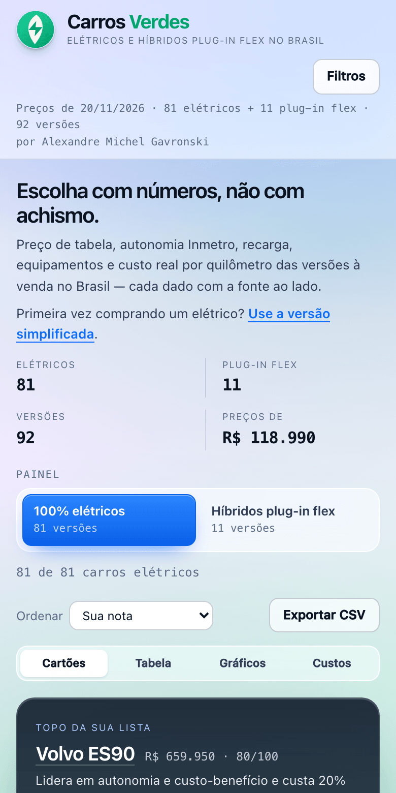
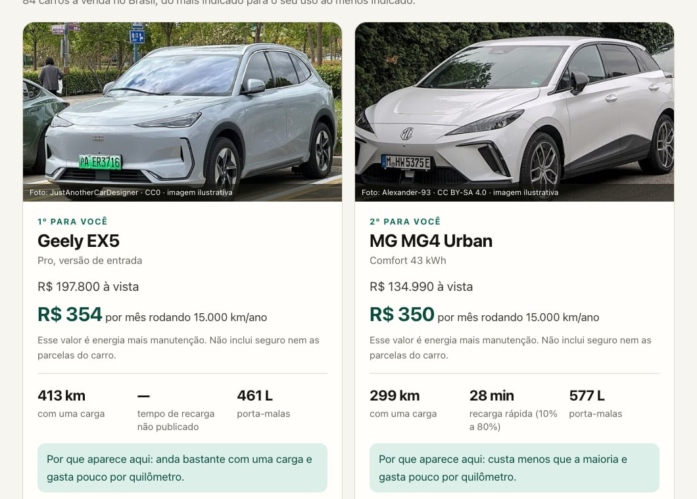
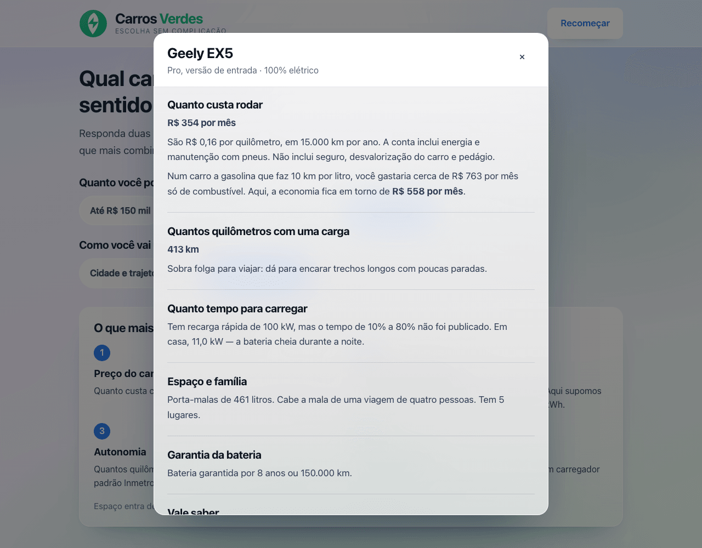
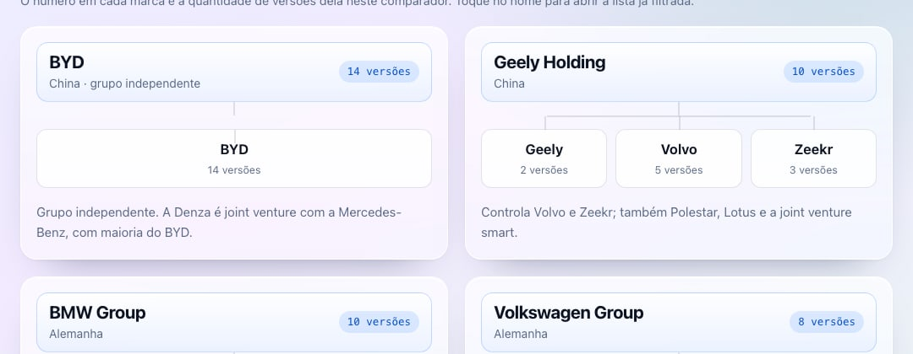

# Carros Verdes

Comparador de carros elétricos e híbridos plug-in flex à venda no Brasil: preço de tabela,
autonomia Inmetro, recarga, equipamentos e custo real por quilômetro — com a fonte de
cada número ao lado.

**Site publicado:** https://alemigav.github.io/carros-verdes/

> **Uso reservado.** © 2026 Alexandre Michel Gavronski. Todos os direitos reservados.
> Este aplicativo **não é software livre** e não é distribuído sob licença aberta.
> O repositório é público para hospedar o site, e isso não concede licença de uso,
> cópia, modificação ou redistribuição. Leia [LICENSE](LICENSE) antes de qualquer
> reuso. Dados de terceiros mantêm suas próprias licenças (ver *Fontes* abaixo).

---

## Duas versões

| Versão | Para quem | Endereço |
| --- | --- | --- |
| **V3 — simplificada** | quem está comprando o primeiro elétrico e quer uma resposta curta | [`/v3/`](https://alemigav.github.io/carros-verdes/v3/) |
| **V2 — completa** | quem quer comparar todos os números e filtrar por tudo | raiz do site |

A V3 faz duas perguntas — quanto você pode gastar e como vai usar o carro — e entrega uma
lista em ordem, com três números grandes por carro (custo por mês, autonomia, porta-malas).
O detalhe fica em dois botões explícitos: **Entender este carro** (explicação em linguagem
simples, com comparação com um carro a gasolina) e **Ficha técnica** (especificação completa
sob demanda). Texto base de 18 px, alvos de toque de 52 px e jargão sempre traduzido.

---

## Telas

| Cartões com veredito do topo da lista | Ficha completa de uma versão |
| --- | --- |
|  |  |

| Comparação lado a lado, com o melhor valor de cada linha | Preço × autonomia |
| --- | --- |
|  |  |

<p align="center">
  
</p>

### V3 — versão simplificada

| Duas perguntas e a hierarquia da decisão | Cartões com custo mensal em destaque |
| --- | --- |
|  |  |

<p align="center">
  
</p>

### Quem é dono de quem



## App Android

Além do site, o projeto tem um **app nativo Android** em Kotlin + Jetpack Compose, pensado para quem
está comprando o primeiro carro eletrificado depois dos 60 anos — sem deixar de dar acesso à ficha
técnica completa de qualquer carro.

Duas portas, uma base de dados só:

| Porta | Para quem | O que faz |
| --- | --- | --- |
| **Me ajude a escolher** | quem quer uma resposta curta | três perguntas, uma por tela, resposta em cartões grandes e leitura em voz alta |
| **Consultar um carro** | quem já sabe o que quer | busca por marca ou modelo e ficha técnica completa, sem responder pergunta nenhuma |
| **Híbridos plug-in flex** | quem está aberto a eles | seção separada, com aviso de que esses carros também queimam combustível |

O que muda em relação ao site: a autonomia aparece em quilômetros **com um exemplo de viagem ao
lado**, o gasto aparece em **reais por mês** comparado ao carro a gasolina, e a recarga é explicada
pelo trabalho que dá (tomada comum, carregador de parede ou planejar a estrada), nunca em kW.

Regra de interface que vale para todas as telas: texto de corpo de 20 sp, alvo de toque de 64 dp,
contraste alto, nenhuma rolagem horizontal, nenhum gesto sem botão equivalente e **campo ausente
sempre vira frase — nunca traço nem zero**.

| Plano e decisões | Como compilar e manter | Publicação |
| --- | --- | --- |
| [`docs/PLANO-APP-ANDROID.md`](docs/PLANO-APP-ANDROID.md) | [`android/README.md`](android/README.md) | [`docs/PLAY-STORE.md`](docs/PLAY-STORE.md) |

### Atualizar os dados do app

O app **não contém nenhum fato sobre carro**: tudo vem de `data/cars.json`, o mesmo arquivo do site.

| O que mudou | O que fazer | Quem já tem o app recebe |
| --- | --- | --- |
| carro, versão ou preço | rodar o pipeline e commitar `data/cars.json` | ao tocar em "Procurar dados novos" |
| campo novo na base | acima + uma linha em `domain/CampoCatalogo.kt` | nova versão do app |
| regra de escolha ou de custo | `Premissas.kt`, `Traducao.kt`, `Ranking.kt` | nova versão do app |

Para empacotar uma base nova junto com o APK, copie o arquivo antes de compilar:

```bash
cp data/cars.json android/app/src/main/assets/cars.json
cd android && ./gradlew :app:testDebugUnitTest :app:bundleRelease
```

Os 24 testes rodam contra o `data/cars.json` real, não contra dados de mentira: se a base mudar de
forma que quebre o app, o build falha antes de gerar o APK.

## O que a interface faz

- **92 versões** no total — 81 elétricos e 11 híbridos plug-in flex, com preço de 20/11/2026.
- **Nota pessoal de 0 a 100**: oito critérios com peso ajustável (custo-benefício,
  autonomia, eficiência, recarga rápida, desempenho, espaço, segurança, conforto).
  Seis presets (Equilibrado, Cidade e economia, Viagens longas, Família, Bem equipado,
  Desempenho).
- **Filtros**: busca por texto, faixa de preço, autonomia, bateria, potência de recarga
  DC, carroceria, marca, tração e dez itens obrigatórios (ACC, AEB, câmera 360°, V2L,
  bomba de calor etc.).
- **Quatro visões**: cartões com veredito do topo da lista, tabela ordenável, gráficos
  (preço × autonomia, km de autonomia mais baratos, mais eficientes) e custo de rodagem
  com parâmetros de uso editáveis.
- **Versões do mesmo modelo**: a ficha lista as outras versões com preço, autonomia e o
  que muda em relação à versão aberta (equipamento, bateria, tempo de recarga), com
  atalho para comparar todas lado a lado — na comparação entre versões do mesmo carro,
  só as linhas que mudam aparecem.
- **Comparação lado a lado** de até quatro versões, com destaque do melhor valor de
  cada linha.
- **Ficha completa** por versão, em nove blocos (preço, **custo de rodagem**, bateria,
  recarga, motorização, dimensões, segurança, conforto, garantia), com fontes,
  observações e indicador de confiança dos dados.
- **Posição, não nota**: cada critério mostra a colocação da versão entre as demais do
  painel (1º é o melhor), e a linha de segurança lista os equipamentos registrados —
  6 airbags, sem piloto adaptativo, 5 de 7 assistentes não publicados — em vez de um
  número que pareça teste de colisão.
- **Quem é dono de quem** (`/marcas/`): mapa dos grupos e suas marcas, com joint ventures
  (Denza, Avatr, Leapmotor, CAOA Changan) e atalho para filtrar o comparador por marca.
- **Preço e custo separados**: "preço ÷ autonomia" mede quanto do valor do carro compra
  cada km de alcance; o gasto real de rodar aparece como R$/km, R$/100 km, R$/mês e
  R$/ano, com as premissas de uso à vista.
- **Exportação CSV** do recorte atual, com BOM e separador `;` para abrir direto no
  Excel em português.
- Campos sem fonte verificável ficam **em branco**, não em zero; cada carro informa
  quantos campos foram verificados.

## Identidade visual

Marca "Carros Verdes": símbolo circular com folha e raio (o elétrico dentro do verde),
wordmark de peso forte com "Verdes" em verde vivo (`#00a36c`).

Tema visual **"liquid glass" claro**, definido em `theme.css` e compartilhado pelas três
páginas: fundo em gradiente de azul, violeta e verde, painéis translúcidos com desfoque,
borda de luz e sombra suave; azul elétrico (`#0b6bff`) nas ações e verde (`#00a36c`) na
marca e nos indicadores de economia.

| Arquivo | Uso |
| --- | --- |
| `assets/mark.svg` | símbolo (folha + raio), usado no cabeçalho e no rodapé |
| `favicon.svg` | favicon simplificado (raio sobre verde), legível em 16 px |
| `assets/logo.svg` | lockup símbolo + wordmark + assinatura |
| `assets/og-image.png` | cartão social 1200×630 |
| `assets/apple-touch-icon.png` | ícone 180×180 para iOS |

## Como rodar localmente

O app é estático, sem build. Precisa de um servidor HTTP porque os dados são buscados
via `fetch` (abrir por `file://` bloqueia a leitura):

```bash
python3 -m http.server 8000 --bind 127.0.0.1
# abra http://127.0.0.1:8000/
```

## Estrutura

```
index.html            marca, hero, filtros, quatro visões, rodapé legal
theme.css             tema compartilhado (cores, vidro, fundo) das três páginas
styles.css            layout, componentes e responsivo da V2
app.js                estado, motor de notas, filtros, fichas, comparação, CSV
views.js              renderizadores (cartões, tabela, gráficos, custos)
data/cars.json        base compilada (92 versões)
data/features/*.json  pesquisa por carro (aplicada sobre aa_fallback.json)
data/build_base.py    planilha → cars_base.json
data/merge.py         base + pesquisa → cars.json
data/extra_versions.json  versões extras de um mesmo modelo, com fonte
data/add_versions.py  aplica as versões extras e recalcula os índices
assets/               marca, ícone social, favicon
marcas/               mapa de grupos, marcas e joint ventures
v3/                   protótipo V3: lista simplificada, linguagem simples
v3/photos/            fotos do Wikimedia Commons (CC) + credits.json
tools/fetch_photos.py baixa, casa e credita as fotos por modelo
android/              app Android nativo (Kotlin + Compose); ver android/README.md
privacidade/          política de privacidade do app (URL exigida pela Play Store)
docs/PLANO-APP-ANDROID.md   plano de produto e arquitetura do app
docs/PLAY-STORE.md    ficha da loja, materiais e passo a passo da publicação
docs/play/            ícone 512×512 e banner 1024×500
```

## Pipeline de dados

`data/build_base.py` lê a planilha `comparativo_eletricos_brasil_20-11-2026.xlsx` e gera
`data/cars_base.json`; `data/merge.py` aplica a pesquisa em `data/features/batch_NN.json`
sobre `aa_fallback.json` (o pesquisado vence) e grava `data/cars.json`. A base guarda o
preço do ano-modelo na versão citada — nunca empresta número de outra versão: campo sem
fonte fica nulo.

## Fontes

- **Recarregados** — ficha dos carros elétricos e híbridos, licença **CC BY 4.0**:
  https://recarregados.com/dados/carros-eletricos-hibridos-ficha
- **Primeiro Carro Elétrico** — catálogo (uso editorial, com link):
  https://www.primeirocarroeletrico.com.br/modelos
- **Eletrificado** — preços de novembro/2026 (uso editorial, com link):
  https://eletrificado.com/precos-carros-eletricos-novembro-2026/
- Páginas de especificações de cada fabricante, listadas na ficha de cada versão.
- **Fotos dos modelos**: Wikimedia Commons, majoritariamente CC BY-SA 4.0, com autor e
  licença em `v3/photos/credits.json` e no crédito de cada imagem. São ilustrativas do
  modelo, não necessariamente da versão vendida no Brasil. Modelos sem foto licenciada
  usam uma ilustração do tipo de carro.

## Licença

Proprietária, com todos os direitos reservados. Ver [LICENSE](LICENSE). O conjunto
Recarregados (CC BY 4.0) e as páginas de fabricantes seguem as licenças de seus autores;
a compilação, a curadoria e a apresentação dos dados neste projeto são reservadas.

Autor: **Alexandre Michel Gavronski** — https://github.com/alemigav
